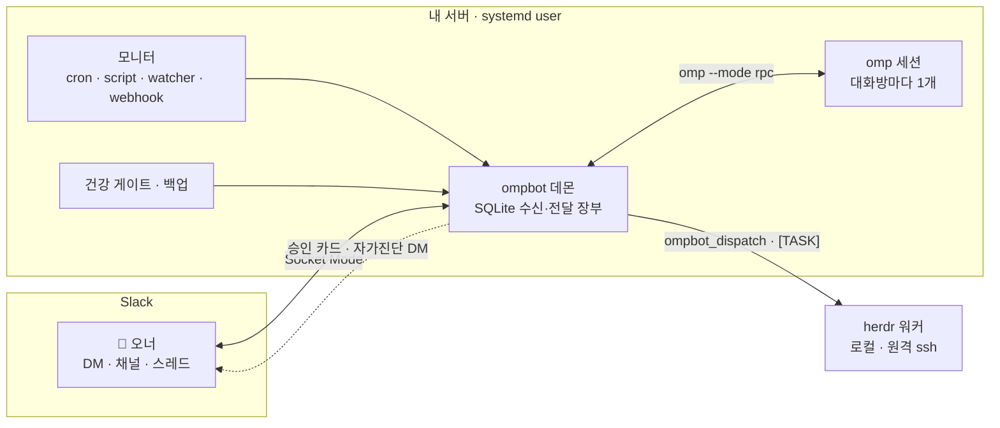

<div align="center">

<h1>ompbot</h1>

**Slack에서 부리는, 나만의 상주 코딩 에이전트**

대화 · 승인 · 위임 · 모니터 · 자가진단까지 — 오너 한 명을 위한 운영형 에이전트 봇

[](LICENSE)
[](https://bun.sh)
[](https://github.com/can1357/oh-my-pi)
[](https://github.com/herdrdev/herdr)
[](https://api.slack.com/apis/socket-mode)


[빠른 시작](#빠른-시작) · [핵심 기능](#핵심-기능) · [작동 방식](#작동-방식) · [명령](#명령-한눈에) · [사용 설명서](docs/guide.md)

</div>

---

ompbot은 Slack DM·채널에서 받은 말을 내 서버의 [omp](https://github.com/can1357/oh-my-pi) 코딩 에이전트에게 넘기고, 답을 같은 스레드로 돌려줍니다. 여기까지는 여느 챗봇과 같습니다. 다른 점은 **그 뒤의 운영**입니다. 되돌릴 수 없는 일은 버튼으로 묻고, 긴 일은 워커에게 맡겨 증거로 완료를 판정하고, 재시작·끊김에도 메시지를 잃지 않고, 스스로 이상을 감지해 알립니다.

> omp는 한 줄도 고치지 않습니다. omp 위에 Slack · 장부 · 승인 · 운영 계층을 얹습니다.

## Slack에서는 이렇게 보입니다

```text
👤  배포 스크립트에서 타임아웃 나는 원인 찾아서 고쳐줘
🤖  ⏳ 작업 중 · 02:14 · 도구 12회
       📋 2/4 · 재시도 대기 원인 확인
       · bun test test/deploy.test.ts
🤖  ✅ 원인은 재시도 대기가 60초로 고정된 것이었습니다. 지수 백오프로 바꾸고 테스트 3개를 추가했습니다.
       바뀐 것 · scripts/deploy.ts  확인한 것 · bun test → 42 pass  남은 것 · main 머지

👤  머지하고 서버 재시작해
🤖  🔐 승인 요청 — 할 일: main 머지 후 서비스 재시작 · 영향: 약 10초 중단 · 되돌리기: 이전 커밋으로 재배포
       [ 승인 ]  [ 거부 ]                                   30분 안에 답이 없으면 거부로 처리합니다

👤  매일 아침 9시에 밤사이 에러 로그 요약해줘
🤖  모니터 '아침 에러 요약'을 등록했습니다 · 매일 09:00 (Asia/Seoul)
       ⋯ 다음 날 아침, DM 최상위에
🤖  ⏰ 아침 에러 요약
       밤사이 에러 2건 — 결제 webhook 타임아웃 1건, 디스크 경고 1건 …
```

<sub>대화 내용은 예시입니다. 진행 상태 메시지, 승인 카드의 항목과 버튼, 모니터 알림 머리말은 실제 동작을 따릅니다.</sub>

## 핵심 기능

<table>
<tr><td width="190"><b>💬 스레드마다 독립 세션</b></td><td>DM·채널·스레드마다 컨텍스트가 섞이지 않는 omp 세션이 열립니다. 일하는 중에 끼워 넣기(steer)와 줄 세우기(<code>!followup</code>), 이미지·문서 첨부, 산출물 파일 업로드, 모델·thinking 전환, 컨텍스트 압축, 옛 세션 이어가기까지 Slack 안에서 합니다. 과거를 가리키는 말("저번에", "어제")에는 같은 대화 공간의 지난 기록을 찾아 붙입니다.</td></tr>
<tr><td><b>🔐 승인 게이트</b></td><td>카드는 되돌리기 어렵거나 밖으로 나가는 일(데이터 삭제·강제 push·키 변경·남이 쓰는 서비스 반영·공개 게시) 앞에서만 띄웁니다. 커밋·비공개 저장소 push·재시작·위임처럼 되돌릴 수 있는 일은 묻지 않고 하고, 보고에 되돌리는 법을 적습니다. 카드에는 할 일·이유·영향·되돌릴 수 없는 이유가 정리됩니다. 승인은 SQLite 장부에 영속되고, 더블클릭·재시작·시간 초과를 모두 안전한 쪽(거부·만료)으로 처리합니다.</td></tr>
<tr><td><b>❓ 질문 카드</b></td><td>omp가 선택지를 묻는 창(select·confirm·input·editor·<code>ask</code>)을 띄우면 그 스레드에 버튼 카드가 올라옵니다. 버튼을 누르거나 카드 스레드에 답장하면 그대로 omp의 답이 되고, 열린 질문이 하나뿐일 때는 같은 대화의 다음 일반 메시지가 그 질문의 답이 됩니다. 마감까지 답이 없으면 omp와 같은 기본값으로 끝나고(<code>ask</code>는 추천 선택지, 없으면 첫 선택지로 자동 선택), 비밀값 입력 창은 슬랙에 받지 않고 바로 취소합니다. <a href="docs/guide.md#질문-카드">질문 카드</a> 참고.</td></tr>
<tr><td><b>🧑‍🏭 작업 위임</b></td><td><code>ompbot_dispatch</code>로 단발 실행(<code>omp -p</code>)하거나 herdr 워커를 로컬·원격(ssh)에 띄웁니다(herdr는 선택 설치). herdr를 켜면 <code>[TASK]</code>를 붙여 워크트리·브랜치·스펙·진행 문서가 한 번에 만들어지고, 5분 스윕이 LLM 없이 수락기준 × 커밋·테스트 증거로 Outcome을 판정합니다. 위험한 지시는 내보내기 전에 걸러 승인을 받습니다.</td></tr>
<tr><td><b>⏰ 모니터</b></td><td>cron · 지정 시각 · 스크립트 조건 · 파일 변경 · webhook 다섯 가지 트리거로 에이전트를 깨웁니다. 변화가 없으면 조용히 넘어가고(<code>[SILENT]</code>, 해시 억제, wake gate), 실패는 10분·1시간·4시간 간격으로 재시도한 뒤 인시던트로 묶어 한 번만 알립니다.</td></tr>
<tr><td><b>📒 잃지 않는 장부</b></td><td>모든 수신·전달을 SQLite에 남깁니다. 꺼져 있던 동안의 메시지는 다시 읽어 오고(백필), 재시작에 끊긴 턴은 세션 기록에서 답을 복구합니다. 재시작은 진행 중인 턴이 끝나기를 기다리고(drain), 앞뒤로 스레드에 알립니다.</td></tr>
<tr><td><b>🩺 자가진단</b></td><td>백업 나이 · 멈춘 턴 · 끊긴 소켓 · 밀린 전달 · 모니터 정지 등 17개 건강 게이트를 5분마다 판정해, 열리면 오너 DM으로 알리고 닫히면 회복을 알립니다. <code>ompbot gates</code>는 판정할 수 있는 게이트가 하나라도 열리면 exit 1이고, 판정 근거가 없는 게이트(unknown — 하트비트·DB가 아직 없음)는 <code>--strict</code>에서 exit 1입니다.</td></tr>
<tr><td><b>📊 현황판</b></td><td><code>ompbot dashboard</code>는 루프백에만 여는 읽기 전용 웹 현황판입니다. 턴 보드(슬랙 스레드마다 카드 하나, <code>확인 필요 / 진행 중 / 완료</code>)·승인 대기·<code>[TASK]</code>·herdr 워커 보드·알림·건강 게이트를 한 화면에 모으고, 워커 보드는 실시간으로, 나머지는 15초마다 갱신합니다. 턴 카드의 <code>대화</code> 탭은 그 스레드의 omp 세션(사용자 글·모델 글·도구 호출과 결과)을 마스킹해 보여 줍니다. 턴이 도는 동안에는 대화 맨 아래 <code>생성 중</code> 블록에 모델이 지금 쓰는 글·생각·준비 중인 도구·실행 중 도구의 부분 출력이 1초 안팎 지연으로 따라오고(현황판이 데몬 소켓에 겹치지 않게 1초마다 묻습니다), 메시지가 끝나면 확정본으로 바뀝니다. claude 에이전트 턴은 실행 중 도구 이름만 보입니다. 자체 인증이 없고 세션 내용까지 보이므로, 밖에서 볼 때는 Cloudflare Access 같은 앞단 인증 프록시 뒤에서만 엽니다.</td></tr>
<tr><td><b>💾 백업과 복구</b></td><td>매일 DB 스냅샷(<code>quick_check</code> 통과분만)과 세션·설정 번들을 남기고, sha256으로 확인하는 오프사이트 복제를 지원합니다. 복구는 <code>ompbot restore</code> 한 줄입니다.</td></tr>
<tr><td><b>🛡️ 보안</b></td><td>오너 외 입력 무시, 실제 비밀 값까지 색인하는 두 겹 마스킹, 자식 프로세스 환경 정리, 비밀 경로 업로드 차단, 인용·첨부 속 인젝션 경고, 디스패치 감사 로그, 한 줄 킬스위치(<code>ompbot freeze</code>).</td></tr>
</table>

## 작동 방식



- **하나의 데몬, 대화방마다 하나의 omp.** 쓰지 않는 omp는 내리고 세션은 남겨, 다음 메시지에 그대로 이어집니다.
- **장부가 진실의 원천.** 수신·전달·승인·모니터·작업이 모두 SQLite(WAL)에 남고, 재시작해도 상태가 이어집니다.
- **사람이 끝을 정합니다.** 봇은 완료 *자격*까지만 판정하고, 완료 처리·머지·배포는 오너가 합니다. 예외는 오너가 `taskAutoLand`로 미리 허락한 개인 저장소 `[TASK]`의 머지 하나입니다(아래).

### `[TASK]` 자동 머지

`[TASK]`가 Outcome에 도달하면 봇은 보통 "머지할까요?" 카드에 `머지` 버튼을 달고 오너의 "머지해"를 기다립니다. `taskAutoLand`를 설정하면 아래 조건을 **모두** 채운 TASK는 봇이 그 스레드에 "머지해"를 직접 넣어 랜딩(close → ff 머지 → push → 워크트리 정리)을 시작하고, 카드는 질문 대신 `🚚 자동 머지` 알림이 됩니다. 서비스 반영(재시작)은 여전히 따로 승인받습니다.

- 봇이 도는 호스트의 TASK입니다. `dispatchHosts`의 원격 TASK는 설정과 관계없이 늘 오너에게 묻습니다.
- TASK 저장소의 git 공통 디렉터리(`git rev-parse --git-common-dir`)가 `repos` 항목 하나와 같습니다. 같은 저장소의 다른 워크트리는 맞고, 이름만 비슷한 다른 저장소는 맞지 않습니다.
- 위험등급이 `maxRisk`(기본 `L2`) 이하입니다.
- 봇이 워크트리에서 직접 다시 돌린 `[check: …]` 검사가 1개 이상이고 모두 통과했습니다.
- 무결성 경고와 "같은 커밋 증거" 경고가 없습니다.
- 봇이 동결(`ompbot freeze`) 상태가 아닙니다.

하나라도 못 채우면 지금처럼 `머지` 버튼 카드가 `자동 머지 안 함: <이유>` 줄과 함께 올라오고, 자동 투입이 실패하면 `⚠️ 자동 머지를 시작하지 못해 직접 정해 주세요.` 줄이 붙은 같은 카드가 올라옵니다. 설정 예시(`~/.ompbot/config.json`, `herdr`가 켜져 있어야 합니다):

```json
"taskAutoLand": { "repos": ["/home/me/work/ompbot", "/home/me/work/home-bot"], "maxRisk": "L2" }
```

`ompbot reload`로 바로 켜고 끕니다(재시작 불필요). 재실행 검사는 수락기준 끝의 `[check: …]`이고 명령은 JSON argv로 씁니다. `[check: command ["bun","run","check"]]`는 받아들이지만 `[check: bun run check]`는 TASK 등록 때 거부됩니다.

## 빠른 시작

**필요한 것:** Linux(WSL2는 `systemd=true`) + systemd user 세션 · [Bun](https://bun.sh) 1.4.4+(omp의 `engines.bun` 이상) · bun 패키지로 설치하고 로그인한 omp · Slack 앱을 만들 권한. 자세한 것은 [요구 사항](docs/guide.md#요구-사항)에 있습니다.

> AI 코딩 에이전트에게 설치를 맡기려면 [AI 에이전트에게 설치 맡기기](docs/guide.md#ai-에이전트에게-설치-맡기기)의 프롬프트를 붙여넣으세요.

**1. 설치**

```sh
bun install -g @oh-my-pi/pi-coding-agent && omp login   # omp가 없을 때만. 단독 바이너리 omp는 쓸 수 없습니다
git clone <이 저장소의 clone URL> ~/work/ompbot && cd ~/work/ompbot
bun install && bun test
```

**2. Slack 앱** — [api.slack.com/apps](https://api.slack.com/apps) → *From a manifest* → [`packaging/slack-manifest.json`](packaging/slack-manifest.json) 붙여넣기 → 봇 토큰(`xoxb-`)과 `connections:write` 앱 토큰(`xapp-`) 발급

봇 답에 오너가 단 👍/👎는 그 답을 낳은 턴의 피드백으로 남고, 현황판 턴 보드·워터폴의 배지와 `bun src/main.ts feedback [--days N] [--json]`(최근 👎 턴 목록)로 봅니다. 이 기능 전에 만든 Slack 앱은 앱 설정에서 `reactions:read` 범위와 `reaction_added`·`reaction_removed` 봇 이벤트를 추가하고 앱을 다시 설치해야 반응이 들어옵니다(토큰이 바뀌면 `secrets/`의 봇 토큰도 바꿉니다).

**3. 홈과 토큰**

```sh
bun src/main.ts init --owner <Slack 멤버 ID>
umask 077
cat > ~/.ompbot/secrets/slack-bot-token   # 봇 토큰 붙여넣고 Ctrl-D
cat > ~/.ompbot/secrets/slack-app-token   # 앱 토큰 붙여넣고 Ctrl-D
```

**4. 점검하고 서비스로 띄우기**

```sh
bun src/main.ts doctor     # 첫 설치에서는 backup bundle 줄 하나만 fail(exit 1)이 정상입니다
bun src/main.ts units render
systemctl --user daemon-reload && systemctl --user enable --now ompbot ompbot-backup.timer ompbot-gc.timer
```

백업은 데몬이 처음 떠서 DB를 만든 뒤에만 됩니다. 서비스를 띄운 다음 `bun src/main.ts backup`을 한 번 돌리면 doctor가 모두 `ok`가 됩니다.

봇에게 DM을 보내 👀와 답이 오면 끝입니다. 설정 키 전체와 백업 타이머 등록은 [사용 설명서 › 설치](docs/guide.md#설치)에 있습니다.

## 명령 한눈에

| Slack에서 | 하는 일 |
| --- | --- |
| 아무 메시지 | omp에게 일을 시킵니다. 작업 중이면 진행 중인 턴에 끼워 넣습니다 |
| `!followup <메시지>` | 끼워 넣지 않고 지금 작업이 끝난 뒤 이어서 보냅니다 |
| `!model` · `!thinking` | 대화방별 모델·thinking 수준을 보거나 바꿉니다 |
| `!compact` · `!resume` · `!new` | 컨텍스트 압축 · 옛 세션 이어가기 · 새 대화 |
| `!queue` · `!status` · `!usage` | 대기열 · 상태 · 토큰·비용 사용량 |
| `!distill` | 지금 대화로 스킬 리뷰를 바로 돌립니다(승인 카드로 제안, 슬래시 명령으로는 등록하지 않음) |
| `작업: <제목> @<경로>` | 그 저장소에서 커밋으로 검증되는 작업 레인을 엽니다 |

위 표의 `!` 명령은 `/new-ompbot` 같은 슬래시 명령으로도 쓸 수 있습니다.

```sh
ompbot status | doctor | gates      # 상태 · 설치 점검(herdr omp 통합 포함) · 건강 판정(열리면 exit 1)
ompbot apply                        # 검증 → 백업 → drain → 재시작 → 준비 확인 → 영수증
ompbot backup | restore | offsite   # 백업 · 복구 · 오프사이트 복제
ompbot monitors … | tasks …         # 모니터 · [TASK] 관리
ompbot dashboard [--port N]         # 읽기 전용 현황판(루프백 HTTP)
ompbot freeze | unfreeze            # 킬스위치
```

<sub>CLI는 체크아웃에서 <code>bun src/main.ts &lt;명령&gt;</code>으로 실행합니다.</sub>

## 문서

| | |
| --- | --- |
| **시작하기** | [요구 사항](docs/guide.md#요구-사항) · [설치](docs/guide.md#설치) · [설정 파일](docs/guide.md#5-설정-파일-ompbotconfigjson) · [서비스 등록](docs/guide.md#7-서비스-등록) · [AI 에이전트에게 설치 맡기기](docs/guide.md#ai-에이전트에게-설치-맡기기) |
| **쓰기** | [대화](docs/guide.md#대화) · [명령](docs/guide.md#명령) · [승인](docs/guide.md#승인) · [페르소나와 답변 형식](docs/guide.md#페르소나와-답변-형식) · [claude 에이전트](docs/guide.md#claude-에이전트) |
| **맡기기** | [작업 위임](docs/guide.md#작업-위임) · [`[TASK]` 상태 문서](docs/guide.md#task-상태-문서) · [작업 레인](docs/guide.md#작업-레인) · [모니터](docs/guide.md#모니터) |
| **운영** | [CLI](docs/guide.md#운영) · [현황판(dashboard)](docs/guide.md#현황판) · [재시작과 drain](docs/guide.md#재시작과-drain) · [건강 게이트](docs/guide.md#건강-게이트와-자가-보고) · [백업](docs/guide.md#백업) · [동결](docs/guide.md#동결킬스위치) |
| **보안** | [보안 메모](docs/guide.md#보안-메모) — 오너 게이트, 비밀 마스킹, 격리의 한계 · [취약점 보고](SECURITY.md) |
| **기여** | [CONTRIBUTING.md](CONTRIBUTING.md) |

## 감사

[omp(oh-my-pi)](https://github.com/can1357/oh-my-pi) 위에서 돌고, 장기 위임은 [herdr](https://github.com/herdrdev/herdr)를 씁니다. 첨부 수신·승인 영속화·모니터 wake gate는 [NousResearch/hermes-agent](https://github.com/NousResearch/hermes-agent)(MIT)의 설계를, 인젝션 경고 규칙은 [rlaope/deepseek-bot](https://github.com/rlaope/deepseek-bot)(MIT)을 참고해 새로 구현했습니다.

## 라이선스

[MIT](LICENSE)
