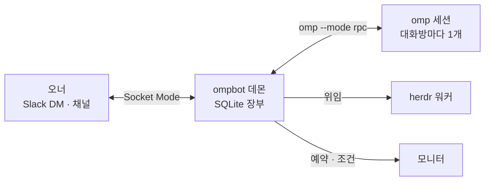

<h1 align="center">ompbot</h1>

<p align="center">
  <strong>Slack 메시지 한 줄로 내 서버의 코딩 에이전트를 부립니다.</strong>
</p>

<p align="center">
  <a href="LICENSE"></a>
  <a href="https://bun.sh"></a>
  <a href="https://github.com/can1357/oh-my-pi"></a>
  
</p>

<p align="center">
  <a href="#빠른-시작">빠른 시작</a> ·
  <a href="docs/guide.md">사용 설명서</a> ·
  <a href="docs/guide.md#명령">명령</a> ·
  <a href="docs/guide.md#보안-메모">보안</a>
</p>

ompbot은 Slack DM·채널에서 받은 말을 내 서버의 [omp](https://github.com/can1357/oh-my-pi) 코딩 에이전트에게 넘기고, 답을 같은 스레드로 돌려주는 오너 전용 상주 봇입니다.



## 주요 기능

- **스레드마다 독립 세션** — 일하는 중 끼워 넣기, 첨부 받기, 파일 올리기까지 Slack 안에서.
- **승인 버튼** — 삭제·배포·push 같은 되돌릴 수 없는 일은 카드로 묻고, 답이 없으면 하지 않습니다.
- **작업 위임** — 긴 일은 herdr 워커에 맡기고, 커밋·테스트 증거로 완료를 판정합니다.
- **모니터** — cron·스크립트 조건·webhook으로 에이전트를 깨워 알립니다.
- **잃지 않는 장부** — 재시작·끊김 뒤에도 놓친 메시지와 답을 복구합니다.
- **자가진단과 백업** — 건강 게이트가 열리면 DM으로 알리고, 매일 백업합니다.

## 빠른 시작

Linux(systemd user), [Bun](https://bun.sh) 1.4+, 로그인된 omp가 필요합니다.

```sh
git clone <저장소 URL> ~/work/ompbot && cd ~/work/ompbot && bun install
bun src/main.ts init --owner <Slack 멤버 ID>     # Slack 앱은 packaging/slack-manifest.json으로 생성
# 토큰을 ~/.ompbot/secrets/slack-bot-token, slack-app-token에 저장(0600)
bun src/main.ts doctor && bun src/main.ts units render
systemctl --user daemon-reload && systemctl --user enable --now ompbot
```

봇에게 DM을 보내 답이 오면 끝입니다. 자세한 단계는 [사용 설명서 › 설치](docs/guide.md#설치)를 보세요.

## 감사

[omp](https://github.com/can1357/oh-my-pi)와 [herdr](https://github.com/herdrdev/herdr) 위에서 돌고, [hermes-agent](https://github.com/NousResearch/hermes-agent)·[deepseek-bot](https://github.com/rlaope/deepseek-bot)(MIT)의 설계를 참고했습니다.

## 라이선스

[MIT](LICENSE)
