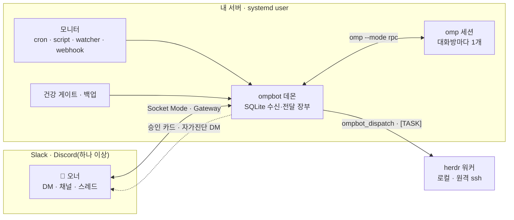

<div align="center">

<h1>ompbot</h1>

**Slack·Discord에서 부리는, 나만의 상주 코딩 에이전트**

대화 · 승인 · 위임 · 모니터 · 자가진단까지 — 오너 한 명을 위한 운영형 에이전트 봇

[](LICENSE)
[](https://bun.sh)
[](https://github.com/can1357/oh-my-pi)
[](https://github.com/herdrdev/herdr)
[](https://api.slack.com/apis/socket-mode)
[](https://discord.com/developers/docs/events/gateway)


[빠른 시작](#빠른-시작) · [핵심 기능](#핵심-기능) · [작동 방식](#작동-방식) · [명령](#명령-한눈에) · [사용 설명서](docs/guide.md)

</div>

---

ompbot은 Slack이나 Discord(둘 중 하나 또는 둘 다)의 DM·채널에서 받은 말을 내 서버의 [omp](https://github.com/can1357/oh-my-pi) 코딩 에이전트에게 넘기고, 답을 같은 스레드로 돌려줍니다. 여기까지는 여느 챗봇과 같습니다. 다른 점은 **그 뒤의 운영**입니다. 되돌릴 수 없는 일은 버튼으로 묻고, 긴 일은 워커에게 맡겨 증거로 완료를 판정하고, 재시작·끊김에도 메시지를 잃지 않고, 스스로 이상을 감지해 알립니다. 봇의 안내·알림 문구와 문서는 한국어입니다.

> omp는 한 줄도 고치지 않습니다. omp 위에 채팅(Slack · Discord) · 장부 · 승인 · 운영 계층을 얹습니다.

## 대화창에서는 이렇게 보입니다

```text
👤  배포 스크립트에서 타임아웃 나는 원인 찾아서 고쳐줘
🤖  ⏳ 작업 중 · 02:14 · 도구 12회
       📋 2/4 · 재시도 대기 원인 확인
       · bun test test/deploy.test.ts
🤖  ✅ 원인은 재시도 대기가 60초로 고정된 것이었습니다. 지수 백오프로 바꾸고 테스트 3개를 추가했습니다.
       바뀐 것 · scripts/deploy.ts  확인한 것 · bun test → 42 pass  남은 것 · main 머지

👤  머지하고 서버 재시작해
🤖  🔐 승인 요청 — 할 일: main 머지 후 서비스 재시작 · 영향: 약 10초 중단 · 되돌리기: 이전 커밋으로 재배포
       [ 승인 ]  [ 거부 ]                                   30분 안에 답이 없으면 거부로 처리합니다

👤  매일 아침 9시에 밤사이 에러 로그 요약해줘
🤖  모니터 '아침 에러 요약'을 등록했습니다 · 매일 09:00
       ⋯ 다음 날 아침, DM 최상위에
🤖  ⏰ 아침 에러 요약
       밤사이 에러 2건 — 결제 webhook 타임아웃 1건, 디스크 경고 1건 …
```

<sub>대화 내용은 예시입니다. 진행 상태 메시지, 승인 카드의 항목과 버튼, 모니터 알림 머리말은 실제 동작을 따릅니다.</sub>

## 빠른 시작

**필요한 것:** Linux(WSL2는 `systemd=true`) + systemd user 세션 · [Bun](https://bun.sh) 1.4.4+(omp의 `engines.bun` 이상) · bun 패키지로 설치하고 로그인한 omp · 채팅 앱 하나 이상(Slack 앱 또는 Discord 봇을 만들 권한 — 하나만 써도, 둘 다 써도 됩니다). 자세한 것은 [요구 사항](docs/guide.md#요구-사항)에 있습니다. 사람이 직접 할 일은 `omp login`, Slack 앱이나 Discord 봇 만들기, 토큰 붙여넣기 셋이고 나머지는 명령이 종료 코드로 성공 여부를 알려 줍니다.

> AI 코딩 에이전트에게 설치를 맡기려면 [AI 에이전트에게 설치 맡기기](docs/guide.md#ai-에이전트에게-설치-맡기기)의 프롬프트를 붙여넣으세요.

**1. omp 준비** — 봇을 돌릴 계정에서 합니다. 단독 바이너리 omp는 쓸 수 없습니다.

```sh
bun install -g @oh-my-pi/pi-coding-agent   # omp가 없을 때만
omp login                                  # 모델 공급자 하나 이상 로그인(자격이 ~/.omp에 저장돼 서비스에서도 쓰임)
omp models                                 # 모델이 하나 이상 보여야 합니다. 비어 있으면 봇의 모든 답이 실패합니다
```

**2. 소스 받기**

```sh
git clone <이 저장소의 clone URL> ~/work/ompbot && cd ~/work/ompbot
bun install && bun test   # fail 0이면 됩니다(실제 omp·gitleaks가 필요한 테스트 30여 개는 skip)
bun link                  # (선택) 이후 'bun src/main.ts <명령>' 대신 'ompbot <명령>'으로 씁니다(~/.bun/bin이 PATH에 있어야 함)
```

**3. 채팅 앱 고르기** — Slack과 Discord 중 하나를 고릅니다(둘 다 쓰려면 Slack으로 설치한 뒤 [Discord](#discord선택)를 더합니다).

- **Slack** — [api.slack.com/apps](https://api.slack.com/apps) → *Create New App* → *From a manifest* → [`packaging/slack-manifest.json`](packaging/slack-manifest.json) 붙여넣기(권한 15개·이벤트 6개·슬래시 명령 12개) → *Install App*에서 봇 토큰(`xoxb-`) → *Basic Information › App-Level Tokens*에서 `connections:write` 앱 토큰(`xapp-`). 화면별 순서는 [Slack 앱 만들기](docs/guide.md#2-slack-앱-만들기)에 있습니다.
- **Discord** — [Discord 봇 만들기](docs/discord.md)를 따라 봇을 만들고 **Message Content Intent**만 켠 뒤 서버에 초대합니다. 봇 토큰, Application ID, 내 사용자 ID(개발자 모드 → 프로필 → *사용자 ID 복사*)를 챙깁니다.

**4. 홈과 토큰** — 3에서 고른 쪽 하나만 합니다.

Slack(멤버 ID는 Slack 프로필 → ⋮ → *멤버 ID 복사*, `U…`):

```sh
bun src/main.ts init --owner <Slack 멤버 ID>
umask 077
cat > ~/.ompbot/secrets/slack-bot-token   # 봇 토큰 붙여넣고 Ctrl-D
cat > ~/.ompbot/secrets/slack-app-token   # 앱 토큰 붙여넣고 Ctrl-D
```

Discord:

```sh
bun src/main.ts init --platform discord --owner <Discord 사용자 ID> --app-id <Application ID>
umask 077
cat > ~/.ompbot/secrets/discord-bot-token   # 봇 토큰 붙여넣고 Ctrl-D
```

**5. 점검하고 서비스로 띄우기**

```sh
bun src/main.ts doctor     # 모든 줄이 ok면 됩니다(첫 설치의 'warn backup bundle' 줄은 종료 코드에 들어가지 않습니다)
bun src/main.ts units render
systemctl --user daemon-reload && systemctl --user enable --now ompbot ompbot-backup.timer ompbot-gc.timer
loginctl enable-linger "$USER"   # (선택) 로그아웃·재부팅 뒤에도 봇이 돌게
```

`doctor`의 `omp models` 줄이 `available=0`이면 1단계의 `omp login`을 봇을 돌리는 계정에서 다시 합니다. 첫 백업은 데몬이 처음 떠서 DB를 만들 때 스스로 만듭니다.

시간대는 기본으로 서버 시간대를 씁니다. 바꾸려면 `config.json`에 `"timezone": "Asia/Seoul"`처럼 IANA 이름을 넣습니다.

봇에게 DM을 보내 👀와 답이 오면 끝입니다. 설정 키 전체는 [사용 설명서 › 설정 파일](docs/guide.md#5-설정-파일-ompbotconfigjson)에 있습니다.

## 핵심 기능

<table>
<tr><td width="190"><b>💬 스레드마다 독립 세션</b></td><td>DM·채널·스레드마다 컨텍스트가 섞이지 않는 omp 세션이 열립니다. 일하는 중에 끼워 넣기(steer)와 줄 세우기(<code>!followup</code>), 이미지·문서 첨부, 산출물 파일 업로드, 모델·thinking 전환, 컨텍스트 압축, 옛 세션 이어가기까지 대화창(Slack·Discord) 안에서 합니다. 과거를 가리키는 말("저번에", "어제")에는 같은 대화 공간의 지난 기록을 찾아 붙입니다. 대화 에이전트는 omp가 기본이고 Claude Code CLI(<code>"agent": "claude"</code>)나 Antigravity CLI(<code>"agent": "agy"</code>)로 바꿀 수 있습니다. 대화 턴이 바꾼 파일은 <code>!undo</code>로 되돌립니다(아래).</td></tr>
<tr><td><b>🔐 승인 게이트</b></td><td>카드는 되돌리기 어렵거나 밖으로 나가는 일(데이터 삭제·강제 push·키 변경·남이 쓰는 서비스 반영·공개 게시) 앞에서만 띄웁니다. 커밋·비공개 저장소 push·재시작·위임처럼 되돌릴 수 있는 일은 묻지 않고 하고, 보고에 되돌리는 법을 적습니다. 카드에는 할 일·이유·영향·되돌릴 수 없는 이유가 정리되고, 밖으로 공개되는 일은 <code>🌐 외부 공개</code> 카드로 따로 드러납니다. 승인 채널에 올린 카드는 요청 스레드에도 사본으로 뜨고, 시간 초과로 끝난 카드에는 <code>다시 요청</code> 버튼이 남습니다. 승인은 SQLite 장부에 영속되고, 더블클릭·재시작·시간 초과를 모두 안전한 쪽(거부·만료)으로 처리합니다.</td></tr>
<tr><td><b>❓ 질문 카드</b></td><td>omp가 선택지를 묻는 창(select·confirm·input·editor·<code>ask</code>)을 띄우면 그 스레드에 버튼 카드가 올라옵니다. 버튼을 누르거나 카드 스레드에 답장하면 그대로 omp의 답이 되고, 열린 질문이 하나뿐일 때는 같은 대화의 다음 일반 메시지가 그 질문의 답이 됩니다. 마감까지 답이 없으면 omp와 같은 기본값으로 끝나고(<code>ask</code>는 추천 선택지, 없으면 첫 선택지로 자동 선택), 비밀값 입력 창은 슬랙에 받지 않고 바로 취소합니다. <a href="docs/guide.md#질문-카드">질문 카드</a> 참고.</td></tr>
<tr><td><b>🧑‍🏭 작업 위임</b></td><td><code>ompbot_dispatch</code>로 단발 실행(<code>omp -p</code>)하거나 herdr 워커를 로컬·원격(ssh)에 띄웁니다(herdr는 선택 설치). herdr를 켜면 <code>[TASK]</code>를 붙여 워크트리·브랜치·스펙·진행 문서가 한 번에 만들어지고, 5분 스윕이 LLM 없이 수락기준 × 커밋·테스트 증거로 Outcome을 판정합니다. 위험한 지시는 내보내기 전에 걸러 승인을 받습니다.</td></tr>
<tr><td><b>⏰ 모니터</b></td><td>cron · 지정 시각 · 스크립트 조건 · 파일 변경 · webhook 다섯 가지 트리거로 에이전트를 깨웁니다. 변화가 없으면 조용히 넘어가고(<code>[SILENT]</code>, 해시 억제, wake gate), 실패는 10분·1시간·4시간 간격으로 재시도한 뒤 인시던트로 묶어 한 번만 알립니다.</td></tr>
<tr><td><b>📒 잃지 않는 장부</b></td><td>모든 수신·전달을 SQLite에 남깁니다. 꺼져 있던 동안의 메시지는 다시 읽어 오고(백필), 재시작에 끊긴 턴은 세션 기록에서 답을 복구합니다. 재시작은 진행 중인 턴이 끝나기를 기다리고(drain), 앞뒤로 스레드에 알립니다.</td></tr>
<tr><td><b>🩺 자가진단</b></td><td>백업 나이 · 멈춘 턴 · 끊긴 소켓 · 밀린 전달 · 모니터 정지 · 하루 비용 상한 등 18개 건강 게이트(오프사이트·herdr·비용 상한을 설정했을 때만 생기는 3개와 장부를 못 읽을 때만 생기는 <code>ledger_unreadable</code> 포함, 기본 설치에서 보이는 것은 14개)를 5분마다 판정해, 열리면 오너 DM으로 알리고 닫히면 회복을 알립니다. <code>ompbot gates</code>는 판정할 수 있는 게이트가 하나라도 열리면 exit 1이고, 판정 근거가 없는 게이트(unknown — 하트비트·DB가 아직 없음)는 <code>--strict</code>에서 exit 1입니다.</td></tr>
<tr><td><b>📊 현황판</b></td><td><code>ompbot dashboard</code>는 루프백에만 여는 읽기 전용 웹 현황판입니다. 턴 보드(슬랙 스레드마다 카드 하나, <code>확인 필요 / 진행 중 / 완료</code>)·승인 대기·<code>[TASK]</code>·herdr 워커 보드·알림·건강 게이트를 한 화면에 모으고, 워커 보드는 실시간으로, 나머지는 15초마다 갱신합니다. 턴 카드의 <code>대화</code> 탭은 그 스레드의 omp 세션(사용자 글·모델 글·도구 호출과 결과)을 마스킹해 보여 줍니다. 턴이 도는 동안에는 대화 맨 아래 <code>생성 중</code> 블록에 모델이 지금 쓰는 글·생각·준비 중인 도구·실행 중 도구의 부분 출력이 1초 안팎 지연으로 따라오고(현황판이 데몬 소켓에 겹치지 않게 1초마다 묻습니다), 메시지가 끝나면 확정본으로 바뀝니다. claude 에이전트 턴은 실행 중 도구 이름만 보입니다. 자체 인증이 없고 세션 내용까지 보이므로, 밖에서 볼 때는 Cloudflare Access 같은 앞단 인증 프록시 뒤에서만 엽니다.</td></tr>
<tr><td><b>💾 백업과 복구</b></td><td>매일 DB 스냅샷(<code>quick_check</code> 통과분만)과 세션·설정 번들을 남기고, sha256으로 확인하는 오프사이트 복제를 지원합니다. 복구는 <code>ompbot restore</code> 한 줄입니다.</td></tr>
<tr><td><b>🛡️ 보안</b></td><td>오너 외 입력 무시, 실제 비밀 값까지 색인하는 두 겹 마스킹, 자식 프로세스 환경 정리, 비밀 경로 업로드 차단, 인용·첨부 속 인젝션 경고, 디스패치 감사 로그, 한 줄 킬스위치(<code>ompbot freeze</code>).</td></tr>
</table>

## 작동 방식



- **하나의 데몬, 대화방마다 하나의 omp.** 쓰지 않는 omp는 내리고 세션은 남겨, 다음 메시지에 그대로 이어집니다.
- **장부가 진실의 원천.** 수신·전달·승인·모니터·작업이 모두 SQLite(WAL)에 남고, 재시작해도 상태가 이어집니다.
- **사람이 끝을 정합니다.** 봇은 완료 *자격*까지만 판정하고, 완료 처리·머지·배포는 오너가 합니다. 예외는 오너가 `taskAutoLand`로 미리 허락한 개인 저장소의 `[TASK]`·작업 레인 머지 하나입니다(아래).


### 더 쓰기

아래는 설정 한 줄로 켜는 선택 기능입니다. 자세한 조건과 예시는 사용 설명서에 있습니다.

- **[`[TASK]`·작업 레인 자동 머지](docs/guide.md#task-자동-머지)** — `taskAutoLand`: 개인 저장소의 `[TASK]`·작업 레인이 재실행 검사(`[check: …]`)까지 통과하면 봇이 직접 ff 머지·push·정리. 서비스 반영은 여전히 승인
- **[턴 되돌리기(`!undo`)](docs/guide.md#턴-되돌리기undo)** — `turnSnapshot.repos`: 대화 턴마다 작업 트리를 스냅샷해 그 턴이 바꾼 파일만 승인 카드 뒤에 되돌림
- **[워커 omp 인자](docs/guide.md#5-설정-파일-ompbotconfigjson)** — `workerOmpArgs`·`dispatchHosts.<h>.ompArgs`: herdr 워커 omp에만 `--prewalk` 같은 인자를 붙임
- **[비용 상한](docs/guide.md#5-설정-파일-ompbotconfigjson)** — `costCap`: 턴·하루 상한, `!budget`으로 확인
- **[Teams 채널](docs/guide.md#teams선택)** — `channels.teams`: Microsoft Teams 1:1·그룹 채팅(멘션)에서 대화, 동료(손님)에게는 웹 검색만 쓰는 읽기 전용 답변(`guestAadObjectIds`)
- **[Teams 채팅 읽기](docs/guide.md#teams-채팅-읽기선택-graph)** — `channels.teams.graph` + `ompbot teams login`: 오너 Teams 1:1에서 오너의 채팅 목록·메시지를 Graph 위임 `Chat.Read`로 읽음

## Discord(선택)

Discord에서 오너 한 명의 DM·서버 채널 대화를 받습니다. Slack 없이 Discord만 써도 되고(빠른 시작 4의 `init --platform discord`), Slack과 같이 써도 됩니다. 대화·`!`/슬래시 명령·승인/질문/TASK 버튼·파일·👍/👎·놓친 메시지 복구·DM 모니터·서버 채널 스레드의 작업 레인·`inject`가 Slack과 같게 동작합니다. 게이트·재시작 같은 데몬 알림은 Slack이 있으면 Slack 오너 DM, 없으면 오너의 가장 최근 1:1 대화로 가고 `!home`으로 바꿀 수 있습니다.

Slack으로 설치한 봇에 Discord를 더할 때:

1. [Discord 봇 만들기](docs/discord.md)를 따라 봇을 만들고 **Message Content Intent**만 켠 뒤 초대합니다.
2. `umask 077; cat > ~/.ompbot/secrets/discord-bot-token`(0600, 한 줄)
3. `config.json`의 `channels`에 `"discord": { "ownerUserId": "…", "botTokenFile": "secrets/discord-bot-token", "applicationId": "…" }`를 더하고 재시작합니다(`reload`로는 반영되지 않음). `doctor`의 `ok discord …` 줄로 확인합니다.

키 전체와 동작은 [사용 설명서 › Discord](docs/guide.md#discord선택)에 있습니다.

## 명령 한눈에

| 대화창에서 | 하는 일 |
| --- | --- |
| 아무 메시지 | omp에게 일을 시킵니다. 작업 중이면 진행 중인 턴에 끼워 넣습니다 |
| `!followup <메시지>` | 끼워 넣지 않고 지금 작업이 끝난 뒤 이어서 보냅니다 |
| `!btw <질문>` | 진행 중인 작업에 끼워 넣지 않고 그 질문에만 바로 답합니다(`💬 곁질문:` 답이 따로 옴, 작업 중이 아니면 일반 메시지로 처리, 슬래시 명령으로는 등록하지 않음) |
| `!model` · `!thinking` | 대화방별 모델·thinking 수준을 보거나 바꿉니다 |
| `!compact` · `!resume` · `!new` | 컨텍스트 압축 · 옛 세션 이어가기 · 새 대화 |
| `!queue` · `!status` · `!usage` | 대기열 · 상태 · 토큰·비용 사용량 |
| `!budget` | 오늘 비용(정가 환산)·상위 오리진·턴/하루 상한을 봅니다. `!budget off`는 오늘만 하루 상한을 꺼 모니터를 다시 돌립니다(봇 시간대 자정에 자동으로 다시 켜짐), `!budget on`은 그날 일찍 다시 켭니다 |
| `!distill` | 지금 대화로 스킬 리뷰를 바로 돌립니다(승인 카드로 제안, 슬래시 명령으로는 등록하지 않음) |
| `!undo` | 이 대화의 가장 최근 변경 턴을 되돌립니다(`turnSnapshot.repos`가 있어야 하며, 승인 카드 뒤에 실행) |
| `!brief` (`!브리핑`) | 지금 상태(주의·진행·모니터·백업)를 폭 1080px 한 장 PNG로 그려 이 스레드에 올립니다(모델 호출 없음, 작업 중에도 사용 가능) |
| `!shutup` · `!unshutup` | 채널 스레드에서 봇을 뮤트하고 풉니다(오너 메시지에도 반응하지 않음, 멘션하면 풀림) |
| `작업: <제목> @<경로>` | 그 저장소 옆 전용 worktree·브랜치(`lane/L-YYYYMMDD-NN`)에서 일하고 커밋으로 검증되는 작업 레인을 엽니다. 닫히면 `머지`·`폐기` 버튼 카드가 올라옵니다 |
| `멈춰` · `계속` | 작업 레인·`[TASK]` 스레드에서 그 일을 멈추거나 다시 돌립니다(레인은 ⏸·▶ 버튼도 됨) |

위 표의 `!` 명령은 `!btw`·`!distill`·`!shutup`·`!unshutup`을 빼고 `/new-ompbot` 같은 슬래시 명령으로도 쓸 수 있습니다.

```sh
ompbot status | doctor | gates      # 상태 · 설치 점검(herdr omp 통합 포함) · 건강 판정(열리면 exit 1)
ompbot apply                        # 검증 → 백업 → drain → 재시작 → 준비 확인 → 영수증
ompbot reload                       # 재시작 없이 config.json 다시 읽기(바로 반영되는 키만)
ompbot omp install|use|rollback|status|prune|sync   # 봇 전용 omp 버전 고정·프로필 동기화(config ompProfile)
ompbot backup | restore | offsite   # 백업 · 복구 · 오프사이트 복제
ompbot monitors … | tasks …         # 모니터 · [TASK] 관리
ompbot dashboard [--port N]         # 읽기 전용 현황판(루프백 HTTP)
ompbot briefing --out <경로>        # !brief와 같은 상태 한 장 PNG(데몬 없이)
ompbot feedback [--days N]          # 최근 👎 받은 턴 목록
ompbot freeze | unfreeze            # 킬스위치
```

<sub>CLI는 체크아웃에서 <code>bun src/main.ts &lt;명령&gt;</code>으로 실행합니다.</sub>

## 문서

| | |
| --- | --- |
| **시작하기** | [요구 사항](docs/guide.md#요구-사항) · [설치](docs/guide.md#설치) · [설정 파일](docs/guide.md#5-설정-파일-ompbotconfigjson) · [서비스 등록](docs/guide.md#7-서비스-등록) · [AI 에이전트에게 설치 맡기기](docs/guide.md#ai-에이전트에게-설치-맡기기) · [Discord 봇 만들기](docs/discord.md) |
| **쓰기** | [대화](docs/guide.md#대화) · [명령](docs/guide.md#명령) · [승인](docs/guide.md#승인) · [질문 카드](docs/guide.md#질문-카드) · [답 피드백](docs/guide.md#답-피드백) · [페르소나와 답변 형식](docs/guide.md#페르소나와-답변-형식) · [claude 에이전트](docs/guide.md#claude-에이전트) · [Discord](docs/guide.md#discord선택) |
| **맡기기** | [작업 위임](docs/guide.md#작업-위임) · [`[TASK]` 상태 문서](docs/guide.md#task-상태-문서) · [`[TASK]` 자동 머지](docs/guide.md#task-자동-머지) · [작업 레인](docs/guide.md#작업-레인) · [모니터](docs/guide.md#모니터) |
| **운영** | [CLI](docs/guide.md#운영) · [현황판(dashboard)](docs/guide.md#현황판) · [봇 전용 omp](docs/guide.md#봇-전용-omp-버전-고정과-프로필) · [재시작과 drain](docs/guide.md#재시작과-drain) · [건강 게이트](docs/guide.md#건강-게이트와-자가-보고) · [백업](docs/guide.md#백업) · [동결](docs/guide.md#동결킬스위치) |
| **보안** | [보안 메모](docs/guide.md#보안-메모) — 오너 게이트, 비밀 마스킹, 격리의 한계 · [취약점 보고](SECURITY.md) |
| **기여** | [CONTRIBUTING.md](CONTRIBUTING.md) |

## 감사

[omp(oh-my-pi)](https://github.com/can1357/oh-my-pi) 위에서 돌고, 장기 위임은 [herdr](https://github.com/herdrdev/herdr)를 씁니다. 첨부 수신·승인 영속화·모니터 wake gate는 [NousResearch/hermes-agent](https://github.com/NousResearch/hermes-agent)(MIT)의 설계를, 인젝션 경고 규칙은 [rlaope/deepseek-bot](https://github.com/rlaope/deepseek-bot)(MIT)을 참고해 새로 구현했습니다.

## 라이선스

[MIT](LICENSE)
